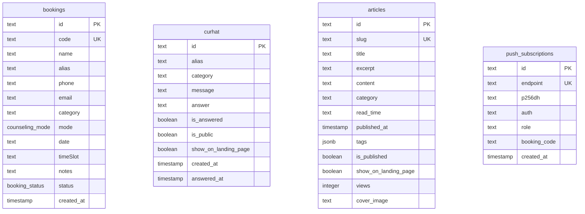

# System Inventory & Architecture Mapping
**Project:** Amelia Portfolio & Islamic Counseling Platform (`amelia-portofolio`)  
**Repository Type:** Single Repository (Next.js 16 App Router)  
**Package Manager:** pnpm 12.4.2  
**Generated Date:** 2026-10-08  

---

## 1. Core Technology Stack & Runtime Specifications

| Category | Technology | Version | Purpose |
|---|---|---|---|
| **Framework** | Next.js | `16.3.8` | React Server Components, App Router, Static Generation, Edge Proxy |
| **UI Library** | React & React DOM | `19.3.0` | Declarative UI, Concurrent Features, React Transitions |
| **Language** | TypeScript | `5.x` | Strict type safety, interface contracts |
| **Styling** | Tailwind CSS | `v4.x` | Modern CSS-first design system (`@import "tailwindcss"`) |
| **Database ORM** | Drizzle ORM & Kit | `0.45.3` / `0.31.11` | Type-safe PostgreSQL schema, migrations, connection management |
| **PostgreSQL Driver** | `postgres` | `3.4.9` | High-performance PostgreSQL client with transaction pooling support |
| **Backend / BaaS** | InsForge | `@insforge/sdk ^1.5.2` | Cloud object storage for article cover image uploads |
| **PWA & Service Worker** | Serwist | `9.5.12` (`@serwist/next`) | Workbox successor for Next.js App Router offline caching |
| **Rate Limiting** | Upstash Redis & Ratelimit | `^1.39.0` / `^2.2.0` | Distributed sliding-window rate limiting (optional fallback in-memory) |
| **Transactional Email** | Resend SDK | `^6.32.0` | Booking confirmations and counselor alerts |
| **Image Processing** | Sharp | `^0.35.5` | Server-side image optimization and WebP conversion |
| **Icons** | Lucide React | `^1.51.0` | Cohesive, feather-weight SVG icon system |
| **Slug Generator** | `@sindresorhus/slugify` | `^3.0.1` | Clean URL slugification |
| **Typography** | Google Fonts | `Newsreader`, `Plus Jakarta Sans` | Next.js optimized zero-layout-shift font loading |

---

## 2. Complete Route Inventory

### 2.1 Public Frontend Routes

| Path | Rendering Strategy | Revalidation | Description |
|---|---|---|---|
| `/` | SSR / ISR (Static) | 60 seconds | Homepage: Hero, Track Record, Approach, Services, Assessment teaser, Curhat wall, Articles preview, PWA showcase. |
| `/about` | Static (SSG) | Build-time | Profile of Amelia: biography, professional journey, youth leadership, skills, CTA. |
| `/services` | Static (SSG) | Build-time | Counseling services catalog: pillars, formats (GMeet, Chat, Tatap Muka), workflow, pricing FAQ. |
| `/assessment` | Dynamic (SSR) | On-demand (Search Params) | Interactive Islamic mental well-being quiz, 24-point scale, score breakdown, local history. |
| `/counseling` | SSR / ISR | 60 seconds | Ruang Curhat: Public story wall, anonymous submission form with autosave, counselor replies. |
| `/schedule` | Dynamic (SSR) | On-demand (Search Params) | 3-step appointment booking wizard, time slots, WhatsApp input, tracking tab (`/schedule?tab=tracker`). |
| `/articles` | SSR / ISR | 60 seconds | Articles directory: category tags, debounced search query (`?q=...`), pagination, reading time. |
| `/articles/[slug]` | SSG + ISR (Dynamic Params) | 60 seconds | In-depth article reader: markdown rendering, dynamic OpenGraph image, share buttons, topic explorer. |
| `/~offline` | Static (SSG) | Cached in SW | PWA offline fallback screen with breathing guidance and emergency contact. |
| `/sitemap.xml` | Dynamic XML Route | On-demand | Dynamic XML sitemap including all static routes and published articles. |
| `/robots.txt` | Dynamic TXT Route | On-demand | Crawler directives with disallow rules for `/admin` and `/api/`. |
| `/manifest.webmanifest`| Dynamic JSON Route | On-demand | PWA Web App Manifest generated from `src/app/manifest.ts`. |

### 2.2 Protected Admin Routes

All admin routes are protected by `src/proxy.ts` (Next.js 16 Edge Proxy) and client-side session checks in `AdminLayoutClient.tsx`.

| Path | Rendering Strategy | Access Control | Purpose |
|---|---|---|---|
| `/admin` | Static / Client Gate | PIN Authentication | Admin portal dashboard: metrics, recent bookings overview, pending curhat alerts. |
| `/admin/bookings` | Static / Client Gate | PIN Authentication | Booking management: status transition (menunggu, terkonfirmasi, selesai, dibatalkan), client contact. |
| `/admin/counseling`| Static / Client Gate | PIN Authentication | Curhat moderation: write counselor responses, toggle public visibility, toggle landing page highlight. |
| `/admin/articles` | Static / Client Gate | PIN Authentication | Article CMS: create, edit, Markdown editor, image uploader, auto-slug generator, drafts. |

### 2.3 Backend API Endpoints

| Endpoint | Method | Auth Required | Rate Limited | Functionality |
|---|---|---|---|---|
| `/api/admin/login` | POST | Public | 5 req / 15 min | Verifies 6-digit PIN and issues HMAC-signed session cookie. |
| `/api/admin/verify` | GET | Public | None | Verifies active session token and returns remaining seconds. |
| `/api/admin/refresh`| POST | Public | None | Extends session by 30 minutes if current token is valid. |
| `/api/admin/logout` | POST | Public | None | Clears admin session cookie. |
| `/api/bookings` | GET | **Admin Only** | None | Retrieves list of bookings (paginated). |
| `/api/bookings` | POST | Public | 10 req / 10 min | Creates new counseling booking; sends confirmation & alert emails. |
| `/api/bookings/[id]` | PATCH | **Admin Only** | None | Updates booking status; sends notification email and Web Push. |
| `/api/bookings/[id]` | DELETE | **Admin Only** | None | Deletes booking record. |
| `/api/bookings/track`| GET | Public | 40 req / 1 min | Retrieves sanitized booking status by code or list of codes. |
| `/api/curhat` | GET | Mixed | None | Public receives published items; Admin receives all. |
| `/api/curhat` | POST | Public | 10 req / 10 min | Creates new anonymous message; sends alert email to counselor. |
| `/api/curhat/[id]` | PATCH | **Admin Only** | None | Submits counselor response, sets answered timestamp, toggles flags. |
| `/api/curhat/[id]` | DELETE | **Admin Only** | None | Deletes curhat item. |
| `/api/articles` | GET | **Public (Flawed)**| None | Retrieves articles (currently returns drafts due to bug SEC-03). |
| `/api/articles` | POST | **Admin Only** | None | Creates new article. |
| `/api/articles/[id]` | PATCH | **Admin Only** | None | Updates existing article by ID. |
| `/api/articles/[id]` | DELETE | **Admin Only** | None | Deletes article by ID. |
| `/api/articles/view` | POST | Public | 30 req / 1 min | Atomically increments article view counter with 24h cookie deduplication. |
| `/api/notifications/subscribe` | POST | Public | **None (Flawed)**| Registers Web Push subscription (allows unverified admin role due to SEC-04). |
| `/api/notifications/subscribe` | DELETE | Public | None | Unregisters Web Push subscription. |
| `/api/translate` | POST | Public | 20 req / 1 min | Translates Indonesian titles to English for slug generation. |
| `/api/upload` | POST | **Admin Only** | None | Uploads and converts article images to WebP via InsForge Storage / Local fallback. |
| `/api/version` | GET | Public | Cached (60s) | Returns current app version and release changelog. |

---

## 3. Data Architecture & Database Schema

The database is built on PostgreSQL with Drizzle ORM (`src/db/schema.ts`):

---

## 4. Environment & Integration Inventory

1. **Local Development (`.env.local`)**:
   - Uses local Node runtime with fallback in-memory data store when `DATABASE_URL` is disconnected.
   - Local filesystem image upload fallback to `public/images/articles/`.
2. **Staging / Preview (Vercel Preview Deployments)**:
   - Serverless environment with ephemeral lambdas.
   - Connection pooler max connection clamped to 1 per lambda (`prepare: false`).
3. **Production (`https://mlyfeblia.vercel.app`)**:
   - Vercel Edge & Serverless network.
   - InsForge PostgreSQL database / cloud storage.
   - Resend API for transactional email dispatch.
   - Serwist PWA service worker with offline precaching.
