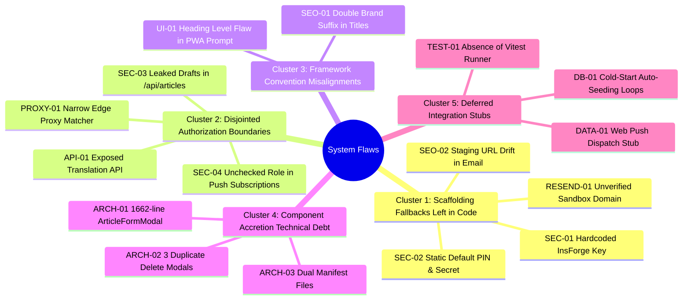

# Root-Cause Clusters & Cross-System Dependency Analysis
**Project:** Amelia Portfolio & Islamic Counseling Platform (`amelia-portofolio`)  
**Lead Evaluator:** Principal Software Architect & Systems Thinking Lead  
**Date:** 2026-10-08  

---

## 1. Root Cause Clustering

Instead of treating the 18 audit findings as disjointed issues, systems analysis identifies **5 core root cause clusters**:

---

## 2. Cluster Profiles & Blast Radius Analysis

### Cluster 1: Scaffolding Fallbacks Left in Code
- **Findings Involved:** SEC-01, SEC-02, SEO-02, RESEND-01
- **Root Cause:** Convenient static fallbacks used during rapid local prototyping (e.g. `'ik_...'`, `'160523'`, `'amelia.portofolio.id'`) were never replaced with strict, fail-safe environment variable assertions before moving to production readiness.
- **Architectural Solution:** Centralize all credentials and environment invariants in `src/lib/env.ts` with strict production validation. If an essential secret is missing in production, fail fast; in development, fall back only to safe local mocks without leaking live keys.

### Cluster 2: Disjointed Authorization Boundaries
- **Findings Involved:** SEC-03, SEC-04, API-01, PROXY-01
- **Root Cause:** Security was applied piecemeal per-route rather than systematically at the architectural boundary. `src/proxy.ts` intercepted only 4 specific paths, leaving newer endpoints like `/api/articles` (GET), `/api/translate`, and `/api/notifications/subscribe` to implement their own security checks—some of which were missed or incomplete.
- **Architectural Solution:** Expand `src/proxy.ts` to intercept `/api/:path*` universally, injecting request tracing and enforcing baseline edge rate limits. In route handlers, establish standardized helper guards (`requireAdmin()`, `requirePublicClient()`).

### Cluster 3: Framework Convention Misalignments
- **Findings Involved:** SEO-01, UI-01
- **Root Cause:** Next.js 15/16 App Router metadata inheritance rules (title templates concatenating `%s | Amelia`) and accessible heading semantics were inadvertently violated by appending hardcoded brand names and fixed heading levels.
- **Architectural Solution:** Strip redundant brand suffixes from child metadata and adjust PWA prompt headers to non-heading semantic containers.

### Cluster 4: Component Accretion Technical Debt
- **Findings Involved:** ARCH-01, ARCH-02, ARCH-03
- **Root Cause:** Features grew organically inside existing components without dedicated refactoring pauses. `ArticleFormModal.tsx` absorbed Markdown tooling, image uploads, slug translation, tag chips, and draft management into one 1,662-line file.
- **Architectural Solution:** Decompose into 4 focused subcomponents sharing a cohesive context, and replace redundant delete modals with the standardized `ConfirmDecisionModal`.

### Cluster 5: Deferred Integration Stubs
- **Findings Involved:** DATA-01, DB-01, TEST-01
- **Root Cause:** Features were stubbed out (Web Push telemetry log, DB auto-seed loop, script-based test runner) and marked as complete before full integration.
- **Architectural Solution:** Complete the VAPID push dispatch pipeline, decouple seeding from read queries, and establish automated unit testing via Vitest.

---

## 3. Cross-System Dependency Graph

```mermaid
flowchart TD
    %% Cluster 1
    C1[Cluster 1: Env & Secrets] --> FixSec[Remove Hardcoded Secrets & Enforce Strict Env]
    FixSec --> SEC01[SEC-01: Clean /api/upload]
    FixSec --> SEC02[SEC-02: Secure ADMIN_AUTH_SECRET]
    FixSec --> SEO02[SEO-02: Unify SITE_URL in Resend]
    
    %% Cluster 2
    C2[Cluster 2: Auth Boundaries] --> ExpandProxy[Expand src/proxy.ts Matcher to /api/*]
    ExpandProxy --> SEC03[SEC-03: Restrict Drafts in /api/articles]
    ExpandProxy --> SEC04[SEC-04: Enforce Auth on Push Admin Roles]
    ExpandProxy --> API01[API-01: Restrict /api/translate to Admin]
    ExpandProxy --> PROXY01[PROXY-01: Universal Request Tracing]
    
    %% Cluster 3
    C3[Cluster 3: SEO & Semantics] --> CleanTitles[Harmonize Metadata & Headings]
    CleanTitles --> SEO01[SEO-01: Fix Duplicate Brand Titles]
    CleanTitles --> UI01[UI-01: Fix PWA H3-before-H1 Heading]
    
    %% Cluster 4
    C4[Cluster 4: Component Debt] --> RefactorComponents[Modularize Components & Modals]
    RefactorComponents --> ARCH01[ARCH-01: Split ArticleFormModal into 4 Files]
    RefactorComponents --> ARCH02[ARCH-02: Consolidate 3 Delete Modals into ConfirmDecisionModal]
    RefactorComponents --> ARCH03[ARCH-03: Unify Manifest to manifest.ts]
    
    %% Cluster 5
    C5[Cluster 5: Deferred Stubs] --> CompleteIntegrations[Complete Stubs & Tooling]
    CompleteIntegrations --> DATA01[DATA-01: Implement Real VAPID Push]
    CompleteIntegrations --> DB01[DB-01: Decouple Auto-Seeding from Reads]
    CompleteIntegrations --> TEST01[TEST-01: Introduce Vitest Suite]
```

