# Master Implementation Plan (Phases 1–8)
**Project:** Amelia Portfolio & Islamic Counseling Platform (`amelia-portofolio`)  
**Lead Evaluator:** Technical Audit Director & Quality Engineering Lead  
**Operating Constraint:** **PLANNING ONLY** — Execution requires explicit user approval.  
**Date:** 2026-10-08  

---

## 1. Implementation Roadmap Overview

```mermaid
flowchart LR
    P1[Phase 1: Quick Wins & Security Lockdown] --> P2[Phase 2: SEO & Metadata Standardization]
    P2 --> P3[Phase 3: Component Modularity & Refactoring]
    P3 --> P4[Phase 4: Edge Proxy & Route Protection]
    P4 --> P5[Phase 5: Web Push VAPID Dispatcher]
    P5 --> P6[Phase 6: Supply Chain & Vitest Testing]
    P6 --> P7[Phase 7: Semantic HTML & A11y Polish]
    P7 --> P8[Phase 8: Final Production Verification]
```



---

## 2. Phase 1: Quick Wins & Security Lockdown (P0 / P1) — [STATUS: COMPLETED & VERIFIED]

**Objective:** Neutralize critical security vulnerabilities, eliminate hardcoded credentials, and close authorization loopholes.  
**Prerequisites:** None.  
**Assigned Agents:** Agent 05 (Security Auditor), Agent 03 (Backend Auditor).  
**Verification:** 16/16 unit tests passed, 21/21 integration tests passed, 0 TypeScript errors, 0 ESLint warnings.  

### Task 1.1: Remove Hardcoded InsForge Storage Secret Literal ([SEC-01])
- **Finding:** `SEC-01` (P0)
- **Target File:** `src/app/api/upload/route.ts`
- **Target Behavior:** Remove `'ik_e3b61cf6ab3a67f8ad99071bfd628605'`. If `process.env.INSFORGE_API_KEY` is missing in serverless production, return HTTP 503 with clean error message. In local development without key, use local storage fallback.
- **Acceptance Criteria:** `git grep "ik_"` yields 0 matches. Uploads continue to work locally and with configured env vars.

### Task 1.2: Enforce Strict Production Environment Assertion ([SEC-02])
- **Finding:** `SEC-02` (P1)
- **Target File:** `src/lib/env.ts`, `src/lib/edge-admin-auth.ts`
- **Target Behavior:** In production (`process.env.NODE_ENV === 'production'`), assert that `ADMIN_AUTH_SECRET` is defined and has length $\ge 32$; warn if `ADMIN_PIN` is set to default `'160523'`.
- **Acceptance Criteria:** Application throws clear startup configuration error if production secret is missing, preventing insecure deployments.

### Task 1.3: Restrict Unpublished Draft Articles in `GET /api/articles` ([SEC-03])
- **Finding:** `SEC-03` (P1)
- **Target File:** `src/app/api/articles/route.ts`
- **Target Behavior:**
  ```ts
  const isAuth = await isAuthenticatedAdmin(request);
  const articles = await getArticles(!isAuth); // onlyPublished = true for public
  ```
- **Acceptance Criteria:** Public requests to `GET /api/articles` return only `isPublished: true` items; authenticated admin requests receive all items.

### Task 1.4: Enforce Admin Authentication on Push Role Assignment & Add Rate Limiting ([SEC-04])
- **Finding:** `SEC-04` (P1)
- **Target File:** `src/app/api/notifications/subscribe/route.ts`
- **Target Behavior:** Add rate limiting (10 req/min). Require `await isAuthenticatedAdmin(request)` to grant `role: 'admin'`; otherwise force `role: 'client'`.
- **Acceptance Criteria:** Unauthenticated POST with `{ role: 'admin' }` saves record with `role: 'client'`.

---

## 3. Phase 2: Technical SEO & Metadata Standardization (P2 / P3) — [STATUS: COMPLETED & VERIFIED]

**Objective:** Fix duplicate brand suffix in HTML `<title>` tags and unify canonical domain URLs.  
**Prerequisites:** Phase 1 complete.  
**Assigned Agents:** Agent 08 (Performance & SEO Auditor).  
**Verification:** Live SSR rendered title test passed (single brand suffix), /manifest.json rewrite 200 OK, 16/16 unit tests, 21/21 integration tests.  

### Task 2.1: Eliminate Double Brand Suffix in Child Page Titles ([SEO-01])
- **Finding:** `SEO-01` (P2)
- **Target Files:**
  - `src/app/articles/page.tsx`
  - `src/app/articles/[slug]/page.tsx`
  - `src/app/counseling/page.tsx`
  - `src/app/assessment/page.tsx`
  - `src/app/schedule/page.tsx`
  - `src/app/services/page.tsx`
  - `src/app/about/page.tsx`
- **Target Behavior:** Remove manual `| Amelia` from child page title strings. Allow `layout.tsx` `%s | Amelia` to append brand cleanly.
- **Acceptance Criteria:** Rendered `<title>` tags across all routes contain exactly one brand mention (`... | Amelia`).

### Task 2.2: Standardize Canonical Domain URL in Resend Module ([SEO-02])
- **Finding:** `SEO-02` (P3)
- **Target File:** `src/lib/resend.ts`
- **Target Behavior:** Replace hardcoded `'https://amelia.portofolio.id'` with centralized `env.SITE_URL`.
- **Acceptance Criteria:** Email template links dynamically resolve to configured site domain.

### Task 2.3: Harmonize PWA Manifest Single Source of Truth ([ARCH-03])
- **Finding:** `ARCH-03` (P3)
- **Target Files:** `public/manifest.json`, `src/app/manifest.ts`, `next.config.ts`
- **Target Behavior:** Retain `src/app/manifest.ts` as canonical manifest; configure rewrite in `next.config.ts` from `/manifest.json` to `/manifest.webmanifest`.
- **Acceptance Criteria:** Browsers requesting either path receive the identical, up-to-date manifest payload.

---

## 4. Phase 3: Component Architecture & Modularity Refactoring (P2 / P3) — [STATUS: COMPLETED & VERIFIED]

**Objective:** Decompose oversized monolithic components and consolidate redundant delete modals.  
**Prerequisites:** Phase 2 complete.  
**Assigned Agents:** Agent 06 (UI/UX Auditor), Agent 02 (Frontend Auditor).  
**Verification:** Subcomponents extracted to form/, 3 delete modals consolidated to ConfirmDecisionModal, 16/16 unit tests, 21/21 integration tests, 0 TS errors, 0 lint warnings.  

### Task 3.1: Decompose `ArticleFormModal.tsx` into Cohesive Subcomponents ([ARCH-01])
- **Finding:** `ARCH-01` (P2)
- **Target Files:** Create `src/components/admin/articles/form/` directory:
  - `ArticleEditorToolbar.tsx`
  - `ArticleCoverPicker.tsx`
  - `ArticleMetaFields.tsx`
  - `ArticlePreviewTab.tsx`
  - `ArticleFormModal.tsx` (reduced from 1,662 lines to < 250 lines)
- **Target Behavior:** Preserve 100% of existing behavior, shortcuts, drafts, and styling while achieving single-responsibility modules.
- **Acceptance Criteria:** All article creation, editing, Markdown formatting, image uploading, and auto-slug generation work identically.

### Task 3.2: Consolidate Redundant Delete Modals into `ConfirmDecisionModal` ([ARCH-02])
- **Finding:** `ARCH-02` (P3)
- **Target Files:**
  - `src/components/admin/bookings/BookingDeleteModal.tsx`
  - `src/components/admin/counseling/CounselingDeleteModal.tsx`
  - `src/components/admin/articles/ArticleDeleteModal.tsx`
- **Target Behavior:** Refactor each to wrap `<ConfirmDecisionModal variant="danger">` or invoke it directly, removing ~500 lines of duplicated modal boilerplate.
- **Acceptance Criteria:** Delete confirmation dialogs retain identical visual appearance, accessibility, and confirmation workflows.

---

## 5. Phase 4: Edge Proxy & Route Protection Expansion (P2) — [STATUS: COMPLETED & VERIFIED]

**Objective:** Broaden Edge-level security coverage and protect translation utility.  
**Prerequisites:** Phase 3 complete.  
**Assigned Agents:** Agent 01 (Architecture Auditor), Agent 05 (Security Auditor).  
**Verification:** Universal /api/:path* matcher in proxy.ts, X-Request-Id header injected, /api/translate 401 unauth / 200 auth verified, 23/23 integration tests passed.  

### Task 4.1: Expand `src/proxy.ts` Matcher to Universal API Coverage ([PROXY-01])
- **Finding:** `PROXY-01` (P2)
- **Target File:** `src/proxy.ts`
- **Target Behavior:** Update matcher to include `/api/:path*`. Apply `X-Request-Id` tracing universally.
- **Acceptance Criteria:** Every API response includes `X-Request-Id` header.

### Task 4.2: Enforce Admin Authentication on Translation API ([API-01])
- **Finding:** `API-01` (P2)
- **Target File:** `src/app/api/translate/route.ts`
- **Target Behavior:** Add `const isAuth = await isAuthenticatedAdmin(req); if (!isAuth) return 401;`.
- **Acceptance Criteria:** Unauthenticated POST to `/api/translate` returns 401 Unauthorized.

### Task 4.3: Harden Client IP Resolution against Spoofing ([SEC-05])
- **Finding:** `SEC-05` (P2)
- **Target File:** `src/lib/rate-limiter.ts`
- **Target Behavior:** Reorder headers: check `x-real-ip` and `cf-connecting-ip` before `x-forwarded-for`.
- **Acceptance Criteria:** Legitimate remote IP is used for rate-limiting bucket key.

---

## 6. Phase 5: Web Push (VAPID) & Realtime Synchronization (P2) — [STATUS: COMPLETED & VERIFIED]

**Objective:** Complete RFC 8291 Web Push dispatch implementation.  
**Prerequisites:** Phase 4 complete.  
**Assigned Agents:** Agent 09 (PWA & Sync Auditor), Agent 03 (Backend Auditor).  
**Verification:** web-push RFC 8291 dispatcher implemented in web-push-server.ts with automatic 404/410 dead endpoint pruning, fallback handling, admin push triggers wired to bookings and curhat routes, 16/16 slug unit tests passed, 25/25 integration tests passed, 44/44 routes compiled in production build.  

### Task 5.1: Implement RFC 8291 Web Push Dispatch via `web-push` ([DATA-01])
- **Finding:** `DATA-01` (P2)
- **Target Files:** `src/lib/web-push-server.ts`, `src/lib/env.ts`
- **Target Behavior:** If `VAPID_PUBLIC_KEY` and `VAPID_PRIVATE_KEY` are configured, send real Web Push payloads to subscribed client endpoints when booking status changes to `terkonfirmasi` or `selesai`. Automatically prune invalid (HTTP 410 Gone) endpoints.
- **Acceptance Criteria:** Client device receives native push notification when counselor updates booking status.

---

## 7. Phase 6: Supply Chain Hygiene & Automated Unit Testing (P2) — [STATUS: COMPLETED & VERIFIED]

**Objective:** Resolve dependency vulnerabilities and install automated unit test runner.  
**Prerequisites:** Phase 5 complete.  
**Assigned Agents:** Agent 10 (DevOps Auditor), Agent 11 (QA Auditor).  
**Verification:** pnpm overrides applied (source-map-js, esbuild, browserslist), pnpm audit --prod reporting 0 vulnerabilities, Vitest installed with vitest.config.mts, 4 test suites / 46 unit tests passing in 1.83s, 25/25 integration tests passed, production Next.js build clean.  

### Task 6.1: Resolve Dependency Advisories via pnpm Overrides ([DEVOPS-01])
- **Finding:** `DEVOPS-01` (P2)
- **Target File:** `package.json`, `pnpm-workspace.yaml`
- **Target Behavior:** Add overrides for `source-map-js >= 1.2.2`, `esbuild >= 0.25.0`, and `browserslist >= 4.28.7`. Run `pnpm install`.
- **Acceptance Criteria:** `pnpm audit --prod` reports 0 vulnerabilities.

### Task 6.2: Install Vitest & Create Core Unit Test Suites ([TEST-01])
- **Finding:** `TEST-01` (P2)
- **Target Files:** `vitest.config.mts`, `src/lib/__tests__/validators.test.ts`, `src/lib/__tests__/text-formatter.test.ts`, `src/lib/__tests__/admin-auth.test.ts`, `src/lib/__tests__/slug-generator.test.ts`
- **Target Behavior:** Fast unit tests running in $< 2\text{s}$ covering input sanitization, PUEBI sentence casing, HMAC token validation, and slug generation.
- **Acceptance Criteria:** `pnpm test` passes with 100% test success rate (46/46 tests passed in 1.83s).

---

## 8. Phase 7: Semantic HTML & Accessibility Elevation (P2) — [STATUS: COMPLETED & VERIFIED]

**Objective:** Correct heading order violation and audit interactive focus flows.  
**Prerequisites:** Phase 6 complete.  
**Assigned Agents:** Agent 06 (UI/UX Auditor).  
**Verification:** Heading order corrected in PwaLifecycle.tsx (semantic p for prompts/banners and h2 for dialog title), all read-time auto-seed write loops eradicated from data-store.ts (getBookings, getBookingById, getBookingByCode, getBookingsByCodes, getCurhatList, getArticles, getArticleBySlug), 46/46 unit tests passing in 1.56s, 25/25 integration tests passing, production build clean.  

### Task 7.1: Resolve PWA Lifecycle Prompt Heading Level ([UI-01])
- **Finding:** `UI-01` (P2)
- **Target File:** `src/components/pwa/PwaLifecycle.tsx`
- **Target Behavior:** Replace `<h3>` in floating prompt with `<p className="font-semibold text-sm">`.
- **Acceptance Criteria:** DOM tree audit confirms `<h1>` in `HeroSection.tsx` is the first major heading on the homepage.

### Task 7.2: Decouple Auto-Seeding Loops from Read Queries ([DB-01])
- **Finding:** `DB-01` (P3)
- **Target File:** `src/lib/data-store.ts`
- **Target Behavior:** Remove read-time insert loops in `getBookings`, `getCurhatList`, and `getArticles`.
- **Acceptance Criteria:** Cold-start read operations execute zero write queries.

---

## 9. Phase 8: Final Production Verification & Quality Sign-Off (P0–P4) — [STATUS: COMPLETED & VERIFIED]

**Objective:** Comprehensive multi-layer regression testing, bundle analysis, and release sign-off.  
**Prerequisites:** Phases 1–7 complete.  
**Assigned Agents:** All Specialized Sub-Agents led by Technical Audit Director.  
**Verification:** All 7 quality gate checkpoints passed with 100% success rate: zero production vulnerabilities, zero TypeScript errors, zero ESLint warnings, 46/46 unit tests passed in 1.70s, 44/44 Next.js production routes compiled, 25/25 integration tests passed, and zero viewport overflow confirmed via Playwright across 375px to 1440px.  

### Quality Gate Checkpoints:
1. `pnpm audit --prod` $\to$ 0 vulnerabilities (PASSED).
2. `npx tsc --noEmit` $\to$ 0 type errors (PASSED).
3. `pnpm lint` $\to$ 0 errors, 0 warnings (PASSED).
4. `pnpm test` $\to$ All 46 Vitest and slug unit tests pass (PASSED).
5. `pnpm build` $\to$ 44/44 routes compile cleanly (PASSED).
6. `pnpm test:integration` $\to$ 25/25 E2E scenarios pass (PASSED).
7. Playwright multi-viewport scan $\to$ Zero horizontal overflow across mobile (375px), tablet (768px), and desktop (1440px) (PASSED).
