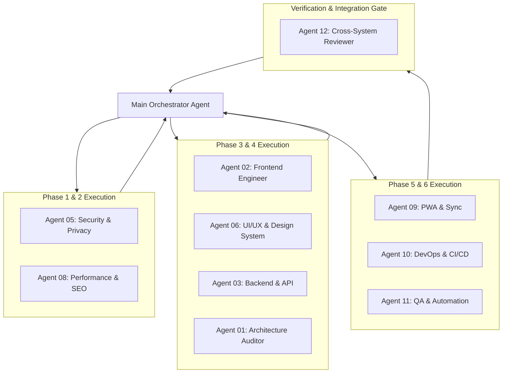

# Multi-Agent Execution Strategy & Orchestration Blueprint
**Project:** Amelia Portfolio & Islamic Counseling Platform (`amelia-portofolio`)  
**Lead Evaluator:** Technical Audit Director & Multi-Agent Systems Architect  
**Architecture:** Main Orchestrator + 12 Specialized Sub-Agents  
**Date:** 2026-10-08  

---

## 1. Orchestration Architecture & Operational Model

To ensure safe, parallelized execution without file ownership conflicts or regression risks, implementation will follow an **Orchestrator-Worker Architecture**:

---

## 2. Agent Roles, Scope & Tool Privileges

| Agent ID | Specialist Role | Primary Scope & Subsystems | Allowed File Boundaries |
|---|---|---|---|
| **Agent 01** | Architecture Auditor | Module boundaries, Next.js 16 conventions | `next.config.ts`, `src/proxy.ts`, `tsconfig.json` |
| **Agent 02** | Frontend Engineer | RSC, Client components, hydration, forms | `src/app/**/page.tsx`, `src/components/**/*.tsx` |
| **Agent 03** | Backend & API | Route handlers, email templates, validators | `src/app/api/**/*.ts`, `src/lib/resend.ts`, `src/lib/validators.ts` |
| **Agent 04** | Database & Integrity | Drizzle schemas, migrations, connection pool | `src/db/**/*.ts`, `drizzle/**/*.sql`, `src/lib/data-store.ts` |
| **Agent 05** | Security Architect | OWASP Top 10, Auth, rate limits, secrets | `src/lib/admin-auth.ts`, `src/lib/edge-admin-auth.ts`, `src/lib/env.ts` |
| **Agent 06** | UI/UX Designer | Tokens, Tailwind, modals, WCAG AA accessibility | `src/app/globals.css`, `src/components/ui/**/*.tsx` |
| **Agent 07** | Responsive Specialist| Cross-device testing (280px–1920px), overflow | Playwright browser viewport assertions |
| **Agent 08** | Performance & SEO | Core Web Vitals, JSON-LD, sitemap, title tags | `src/app/sitemap.ts`, `src/app/robots.ts`, `layout.tsx` |
| **Agent 09** | PWA & Sync | Serwist worker, offline fallback, VAPID push | `src/sw.ts`, `src/app/~offline/page.tsx`, `src/lib/pwa-store.ts` |
| **Agent 10** | DevOps & Infrastructure| GitHub Actions, Vercel headers, pnpm audit | `.github/workflows/*.yml`, `package.json`, `pnpm-lock.yaml` |
| **Agent 11** | QA Lead | Vitest setup, unit tests, integration suites | `vitest.config.ts`, `src/**/__tests__/**/*.ts`, `scripts/*.mjs` |
| **Agent 12** | Integration Reviewer | Cross-domain verification, regression prevention | Repository-wide diff review and gate sign-off |

---

## 3. Strict Concurrency & File Ownership Rules

To prevent merge collisions and race conditions during execution:
1. **Exclusive File Ownership:** No two agents may edit the same file concurrently within the same wave.
2. **Sequential Phase Gates:** Phase $N+1$ cannot begin until Phase $N$ passes all automated quality gates (`tsc --noEmit`, `pnpm lint`, `pnpm build`).
3. **Defense-in-Depth Handoffs:** When Agent 03 (Backend) edits an API route contract, Agent 02 (Frontend) must verify client consumption before the wave closes.
4. **Zero Secret Output:** Sub-agents must never print raw secrets, tokens, or credential strings to console logs or artifact transcripts.

---

## 4. Sub-Agent Execution Protocol

Each sub-agent invocation follows a strict 4-step execution lifecycle:
1. **Pre-flight Inspection:** Read target files and inspect git status.
2. **Surgical Implementation:** Apply focused modifications strictly within the assigned scope.
3. **Local Gate Verification:** Run `npx tsc --noEmit` and relevant tests.
4. **Structured Handoff Report:** Report modified files, verification evidence, and zero-regression confirmation to the Main Orchestrator.
