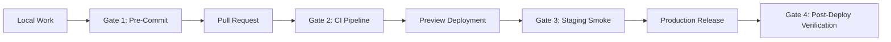

# Validation, Quality Gates & Release Strategy
**Project:** Amelia Portfolio & Islamic Counseling Platform (`amelia-portofolio`)  
**Lead Evaluator:** Quality Engineering Lead & DevOps/SRE Engineer  
**Scope:** Continuous Testing, Quality Gates, Deployment Protocols, and Disaster Recovery  
**Date:** 2026-10-08  

---

## 1. Overview & Quality Engineering Philosophy

To guarantee zero regression, operational continuity, and bulletproof security during the execution of the Master Implementation Plan, this strategy establishes a four-tier quality gate framework. All changes must pass strict automated gates prior to staging or production promotion.



---

## 2. Testing Matrices

| Test Level | Scope | Framework / Tool | Frequency & Execution | Pass Criteria |
|---|---|---|---|---|
| **Unit Testing** | Slug generation, utility functions, validator schemas, token parsers | Node test runner (`node --test`), Vitest / Jest syntax | Pre-commit & CI | 100% pass, zero regressions (`pnpm test:slug`) |
| **Static Analysis** | TypeScript type safety, ESLint rules, Next.js conventions | `tsc --noEmit`, `next lint` | Pre-commit & CI | 0 errors, 0 warnings |
| **Dependency Audit** | CVE scanning on production and build packages | `pnpm audit` | CI Daily & Pre-release | 0 Critical, 0 High vulnerabilities |
| **Integration Testing**| SSR output, API route status codes, cookie auth, rate-limiting | Custom Node runner (`pnpm test:integration`) | Pre-merge & Staging | 21/21 suites passing against running instance |
| **End-to-End (E2E)** | User booking flow, admin session CRUD, article publishing | Playwright CLI (`playwright test`) | CI & Nightly | All critical user journeys succeed without console errors |
| **Visual & Responsive**| Horizontal scroll overflow checks across 10 viewports (280px–1920px) | Playwright browser automation script | Pre-release | Horizontal overflow = 0px, zero layout shift (CLS = 0) |
| **Accessibility** | ARIA compliance, color contrast, keyboard nav, heading hierarchy | axe-core via Playwright, Lighthouse | CI Staging | WCAG 2.1 Level AA compliant, 0 critical violations |
| **Performance** | Core Web Vitals (LCP, INP, CLS), Bundle size analysis | Lighthouse CI, Next.js build stats | Pre-release | LCP < 2.0s, CLS = 0, FID/INP < 100ms, Initial JS < 180kB |
| **Security Audit** | RLS enforcement, auth bypass checks, secret leak regex | Non-destructive automated security scanner | CI & Pre-deploy | 0 secret leaks, 401/403 enforced on protected endpoints |

---

## 3. Four-Tier Quality Gate System

### Gate 1: Local / Pre-Commit Gate
- **Enforced via:** Husky / git pre-commit hook (or manual developer verification script).
- **Checks:**
  1. `git diff --staged` secret scan (preventing `.env`, raw keys, or tokens from being committed).
  2. `pnpm run lint` (ESLint 9 + Next Core Web Vitals).
  3. `npx tsc --noEmit` (strict TypeScript validation).
  4. `pnpm test:slug` (fast unit tests).
- **Failure Action:** Commit is rejected locally.

### Gate 2: Pull Request / CI Pipeline Gate
- **Enforced via:** GitHub Actions Workflow (`.github/workflows/ci.yml`).
- **Checks:**
  1. Clean dependency install (`pnpm install --frozen-lockfile`).
  2. `pnpm audit --prod` (security vulnerability scan).
  3. Typecheck & Lint (`tsc --noEmit && pnpm lint`).
  4. Production Build Verification (`pnpm build`).
  5. Integration & E2E Test Suite against local test server.
- **Failure Action:** Pull request merge blocked; notifications dispatched to PR author.

### Gate 3: Staging & Preview Deployment Gate
- **Enforced via:** Vercel Preview Deployment inspection.
- **Checks:**
  1. Preview deployment builds cleanly with preview environment variables.
  2. Automated Playwright smoke suite runs against the preview URL.
  3. Verification that fallback in-memory store cleanly handles mock requests if DB is unreachable.
  4. Manual review of UI/UX changes on mobile and desktop viewports.
- **Failure Action:** Release candidate halted; staging branch remains unmerged to `main`.

### Gate 4: Production Release & Post-Deployment Gate
- **Enforced via:** Post-deployment automation script & SRE smoke check.
- **Checks:**
  1. Health check probe (`GET /api/health` returns `200 OK` with database status `healthy`).
  2. Core public routes (`/`, `/articles`, `/counseling`, `/services`) return `200 OK` with valid HTML.
  3. Admin authentication check (`POST /api/admin/verify-pin` rejects invalid PIN, accepts valid PIN and issues HTTP-only cookie).
  4. Vercel Realtime Logs & Sentry monitoring checked for spike in 5xx errors over first 15 minutes.
- **Failure Action:** Immediate trigger of the Fast-Rollback Protocol.

---

## 4. Rollback Mechanisms & Disaster Recovery

### 4.1 Zero-Downtime Rollback (Vercel)
Vercel keeps immutable instant deployments:
- **Instant Rollback:** If unexpected 5xx spikes or critical functional breaks occur post-deployment:
  ```bash
  # Instant revert via Vercel CLI
  vercel rollback [DEPLOYMENT_ID]
  ```
- **Dashboard Action:** Navigate to Project Overview -> Deployments -> Prior Stable Deployment -> Click "Promote to Production". Reversion completes in under 15 seconds with zero build delay.

### 4.2 Database Migration Rollback Strategy
Database schema changes must adhere to the **Expand and Contract Pattern**:
1. **Never drop columns or tables immediately:**
   - Step 1: Add new columns as optional/nullable (`Expand`).
   - Step 2: Update code to write to both old and new columns, and read from new.
   - Step 3: Backfill historical data.
   - Step 4: After 2 stable release cycles, drop old columns (`Contract`).
2. **Reversible SQL Scripts:** Every Drizzle migration script must have an accompanying `down.sql` rollback file in `drizzle/rollback/`.
3. **Database Pre-Migration Snapshots:**
   - Execute a complete logical backup prior to any DDL migration:
     ```bash
     pg_dump --clean --if-exists -d "$DATABASE_URL" > "backup_pre_migration_$(date +%Y%m%d_%H%M%S).sql"
     ```

### 4.3 Environment Variable & Secret Recovery
- Secrets are backed up in secure key management vaults (never in Git).
- In the event of a compromised secret (e.g., historical API key leakage):
  1. Generate new credentials in the respective service console (Resend, InsForge, Push VAPID).
  2. Update environment variables in Vercel project settings.
  3. Trigger zero-code redeploy to propagate new secrets.
  4. Revoke compromised keys in external consoles.

---

## 5. Observability & Performance Budgets

### Performance Budgets
- **Lighthouse Performance Score:** $\ge 95/100$ on Mobile, $\ge 98/100$ on Desktop.
- **First Contentful Paint (FCP):** $\le 1.2\text{s}$.
- **Largest Contentful Paint (LCP):** $\le 2.0\text{s}$.
- **Cumulative Layout Shift (CLS):** $= 0.000$.
- **Interaction to Next Paint (INP):** $\le 100\text{ms}$.
- **Initial JavaScript Bundle:** $\le 180\text{kB}$ uncompressed per page.

### Live Telemetry & Error Thresholds
- **5xx Error Rate Threshold:** Alert if $> 0.5\%$ of total requests over 5 minutes.
- **API Response Latency:** Alert if $P_{95} > 800\text{ms}$ for non-upload endpoints.
- **Health Check Ping:** Monitored externally every 60 seconds.
