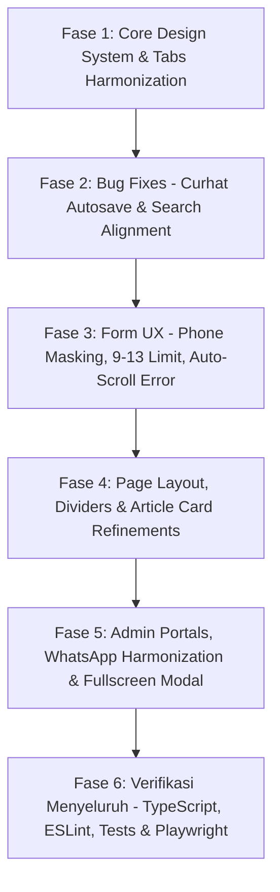

# MASTER IMPLEMENTATION PLAN — UI/UX REFINEMENT, DESIGN SYSTEM HARMONIZATION & INTERACTION ARCHITECTURE

> **Audit Date:** 2026-10-09  
> **Status:** AUDIT & PLANNING COMPLETE — PENDING USER APPROVAL  
> **Target Branch:** `main`  
> **Scope:** Assessment History, Counseling Autosave Bug, Category Tabs Design System, Article List Dividers & Meta, Related Articles Card, Layout Footer Spacing, Search Input Alignment, Form Phone Masking & Limits, Validation Auto-Scroll, Button Hierarchy & WhatsApp Color Harmonization, Admin Counseling Reply Modal, Admin Article Header Toolbar, Text Selection Hygiene.

---

## 1. Executive Summary & Audit Matrix

Audit mendalam terhadap seluruh poin yang disampaikan user telah selesai dilakukan melalui inspeksi kode aktual, riwayat git, dan verifikasi lintas komponen. 

Berikut matriks temuan hasil audit:

| ID | Subsistem / Halaman | Masalah Aktual | Klasifikasi | Akar Masalah (Root Cause) |
| :--- | :--- | :--- | :---: | :--- |
| **F-01** | `/assessment?tab=history` | Tombol *"Lihat Rekomendasi & Catatan Lengkap"* di mobile terbelah jadi 2 baris; tombol *"Konsultasikan"* belum menjadi tombol utama dan posisinya berada di bawah toggle rincian. | **CONFIRMED** | Label tombol terlalu panjang untuk viewport mobile (`px-2.5 text-[11px] min-[340px]:text-xs`), tata letak flex-col menempatkan toggle rincian sebelum tombol WhatsApp, dan tombol konsultasi masih bergaya badge/secondary (`bg-emerald-50 text-emerald-800`). |
| **F-02** | `/counseling` (`CurhatForm.tsx`) | Draf yang sudah dikosongkan/dihapus oleh user muncul kembali setelah halaman di-refresh atau berpindah halaman. | **CONFIRMED** | Logika autosave pada baris 58 memiliki guard `if (!message && !alias) return;`. Ketika input dikosongkan total, efek me-return early tanpa memanggil `sessionStorage.removeItem('curhat_draft_v1')`, sehingga draf lama di penyimpanan browser tetap tersimpan dan dipulihkan kembali saat reload. |
| **F-03** | Seluruh Website & Admin (`Tabs.tsx`) | Tombol kategori/topik berubah bentuk menjadi lingkaran/oval bulat (`rounded-full`) yang kurang rapi dan memanjang aneh. | **CONFIRMED** | Varian `pills` pada `TabsTrigger` di `Tabs.tsx` baris 366 menggunakan `rounded-full` dengan padding `px-3 sm:px-4 py-2` dan `min-h-[44px] sm:min-h-[38px]`, menggantikan gaya `rounded-xl` yang compact dan kotak rapi seperti tombol. |
| **F-04** | `/articles` (`ArticlesDirectory.tsx`) | Terlihat 2 garis pemisah (double divider) bertumpuk di atas tulisan *"Menampilkan 1-6 dari 10 artikel"*. | **CONFIRMED** | Kontainer daftar artikel menggunakan `divide-y border-y` (yang memberikan border bawah), kontainer utama memiliki `space-y-6`, dan komponen `PaginationBar` memiliki `border-t`, menghasilkan dua garis horizontal terpisah jarak 24px di atas counter. |
| **F-05** | `/articles` Card List | Estimasi waktu baca masih menggunakan bullet dot (`&bull;`) yang terkesan seperti titik kedap-kedip. | **CONFIRMED** | `ArticleListItem.tsx` merender `<span aria-hidden="true">&bull;</span>` sebelum string `article.readTime`, tanpa ikon jam (`Clock`). |
| **F-06** | `/articles/[slug]` (Refleksi Terkait) | Tombol *"Baca"* hanya berupa plain link teks tanpa pembungkus tombol, serta belum menampilkan metrik jumlah pembaca (`views`). | **CONFIRMED** | Bagian Tulisan Terkait merender link `inline-flex text-[var(--color-accent)]` tanpa container `btn-secondary` dan tidak memiliki pembacaan properti `rel.views`. |
| **F-07** | Seluruh Halaman Publik (Layout & Footer) | Jarak dari konten ke footer terlalu jauh dan berongga, terutama ketika artikel/data sedikit (contoh: kategori Pengembangan Diri). | **CONFIRMED** | Tag `<main id="main-content" className="min-h-screen ...">` memaksa `<main>` memiliki tinggi minimal 100vh di luar Navbar dan Footer. Saat konten pendek, terbentuk ruang kosong ratusan piksel sebelum footer. |
| **F-08** | `/counseling` (`CurhatWall.tsx`) | Saat mengetik pada kolom pencarian, ikon kaca pembesar dan tombol `X` (clear) turun ke bawah dan layout berantakan. | **CONFIRMED** | Elemen `<input>` di `.search-input` tidak memiliki `display: block` eksplisit dan menggunakan inline padding `pl-8 pr-8 py-1.5` yang tidak mengunci tinggi kontainer, sehingga pergeseran baseline saat teks diketik menyebabkan ikon `top-1/2 -translate-y-1/2` bergeser vertikal. |
| **F-09** | Form Input & Textarea System | Ketiadaan tombol clear (`X`) pada kolom pencarian/kode yang relevan serta scrollbar textarea default yang kaku saat kursor berada di textarea. | **IMPROVEMENT** | Belum ada standardisasi input dengan clear action yang proporsional dan custom smooth scrollbar utility untuk textarea panjang. |
| **F-10** | `/schedule` / `/booking` (No. WhatsApp) | Kolom nomor WhatsApp kosong secara default, belum memiliki format tampilan terpisah tanda hubung (`0812-3456-7890`), serta belum dibatasi 9–13 digit di input masking & validasi. | **CONFIRMED** | `DEFAULT_BOOKING_FORM.phone` bernilai string kosong `''`, handler input hanya melakukan sanitasi karakter tanpa auto-masking `08` dan pemisah `-`, serta regex validasi belum membatasi batas atas 13 digit. |
| **F-11** | UX Validasi Form | Saat validasi form gagal (misal nama kosong), hanya muncul banner error tanpa auto-scroll dan auto-focus ke kolom yang belum diisi. | **CONFIRMED** | `BookingSection.tsx` dan `CurhatForm.tsx` hanya mengeksekusi `setError(...)` tanpa memanggil `scrollIntoView` dan `.focus()` pada elemen input yang tidak valid. |
| **F-12** | `/schedule?tab=tracker` (Mobile History) | Di mobile, pembungkus kode referensi (`BK-...`) kelihatan kebesaran dan tidak rapi dengan elemen sekitarnya. | **CONFIRMED** | Kartu histori di mobile memiliki padding besar `p-4 sm:p-5`, badge kode menggunakan padding `px-2.5 py-1` yang tidak proporsional dengan status pill di sebelahnya, dan link *"Pantau Perkembangan"* belum terstandarisasi. |
| **F-13** | Tombol *"Pantau Perkembangan"* | Tombol *"Pantau Perkembangan"* pada kartu histori tracker hanya berupa plain span link teks dengan panah kecil tanpa pembungkus tombol. | **CONFIRMED** | Baris 654-657 di `BookingTracker.tsx` hanya merender `<span>Pantau Perkembangan</span><ArrowRight />` tanpa gaya `btn-secondary`. |
| **F-14** | Konsistensi Warna WhatsApp | Tombol WhatsApp di website menggunakan warna-warna hijau cerah yang saling bertabrakan: `#25D366` (neon terang di admin bookings), `bg-emerald-600` (di booking detail), dan `border-emerald-200 bg-emerald-50` (di assessment history). | **CONFIRMED** | Tidak ada token warna WhatsApp yang harmonis dengan palet utama web (`--color-accent: #1A563C`). Tombol WhatsApp sekunder tampak lebih mencolok daripada tombol utama. |
| **F-15** | `/admin/counseling` (Ubah Tanggapan) | Tombol *"Ubah Tanggapan"* terlalu besar dibanding tombol admin lain, dan form tanggapan hanya muncul inline di dalam kartu yang sempit di mobile. | **CONFIRMED** | `CounselingCard.tsx` merender tombol tanggapan dengan padding besar dan merender `CounselingReplyBox` secara inline di dalam kartu tanpa modal fullscreen khusus mobile. |
| **F-16** | `/admin/articles` (Tombol Tambah Artikel) | Tombol *"Tambah Artikel"* perlu memiliki ukuran dan bentuk yang identik dengan tombol *"Segarkan"* dan *"Kotak Draf"*, tetapi tetap mempertahankan status visual sebagai tombol utama (primary accent). | **CONFIRMED** | Toolbar di `ArticleHeader.tsx` memerlukan penyamaan dimensi container (`h-8`, `rounded-xl`, `px-3 py-2`) dengan visual weight tombol utama yang tegas. |
| **F-17** | Text Selection Hygiene (`user-select`) | Belum ada pemisahan tegas antara teks yang boleh diblok/disalin (artikel, kode booking, curhat, respons, skor) dengan elemen UI kontrol yang harus `select-none`. | **CONFIRMED** | `header` di `globals.css` memiliki `user-select: none` yang berpotensi memblokir seleksi judul artikel di Safari, sementara kontrol kartu belum sepenuhnya terproteksi dari seleksi tap mobile. |

---

## 2. Arsitektur Solusi & Spesifikasi Teknis

### 2.1 Assessment History Compact Layout & Button Hierarchy
- **File:** `src/components/assessment/AssessmentHistory.tsx`
- **Solusi:**
  1. Ubah susunan aksi pada kartu riwayat di mobile menjadi:
     - **Baris 1 (Mobile Atas):** Tombol **"Konsultasikan via WhatsApp"** menjadi **Tombol Utama** (`btn-primary` dengan background harmonis, icon `MessageCircle`, lebar penuh `w-full sm:w-auto`, tinggi compact `h-8 sm:h-8`).
     - **Baris 2 (Mobile Bawah):** Tombol **"Lihat Catatan & Rincian"** / **"Sembunyikan Rincian"** sebagai tombol sekunder (`btn-secondary` outline, compact, 1 baris tanpa wrapping `whitespace-nowrap`).
  2. Pada desktop (`sm:` ke atas), kedua tombol kembali berdampingan horizontal (`justify-between`).

### 2.2 Perbaikan Bug Autosave CurhatForm
- **File:** `src/components/counseling/CurhatForm.tsx`
- **Solusi:**
  1. Hapus guard early-return `if (!message && !alias) return;`.
  2. Di dalam debounced timer:
     ```tsx
     if (!message.trim() && !alias.trim()) {
       sessionStorage.removeItem('curhat_draft_v1');
       setIsDraftSaved(false);
     } else {
       sessionStorage.setItem('curhat_draft_v1', JSON.stringify({ message, alias, category }));
       setIsDraftSaved(true);
     }
     ```
  3. Memastikan saat user menghapus seluruh isi form, draf di `sessionStorage` seketika dibersihkan dan tidak muncul kembali saat reload.

### 2.3 Standarisasi Tombol Kategori / Topik (Tabs Pills)
- **File:** `src/components/ui/Tabs.tsx`
- **Solusi:**
  1. Ubah varian `pills` pada `TabsTrigger` dari `rounded-full min-h-[44px]` menjadi `rounded-xl min-h-[34px] sm:min-h-[36px] px-3 sm:px-3.5 py-1.5 text-xs sm:text-sm font-medium`.
  2. Badge counter kategori menggunakan `rounded-md font-mono text-[10px] px-1.5 py-0.5`.
  3. Mengembalikan bentuk tombol kategori di `/articles`, `/counseling`, `/admin/articles`, `/admin/bookings`, dan `/admin/counseling` menjadi mengkotak rapih, elegan, dan proporsional.

### 2.4 Eliminasi Garis Ganda di /articles
- **File:** `src/components/articles/ArticlesDirectory.tsx`
- **Solusi:**
  1. Ubah container daftar artikel dari `divide-y divide-[var(--color-paper-border)] border-y border-[var(--color-paper-border)]` menjadi `divide-y divide-[var(--color-paper-border)] border-t border-[var(--color-paper-border)]`.
  2. Garis penutup bawah daftar artikel disediakan tunggal oleh `PaginationBar` (`pt-4 border-t border-[var(--color-paper-border)]`), menghilangkan garis pemisah kedua yang membingungkan.

### 2.5 Ikon Jam Waktu Baca pada Card Artikel
- **File:** `src/components/articles/ArticleListItem.tsx`, `src/components/home/ArticlesPreviewSection.tsx`
- **Solusi:**
  1. Ganti pemisah titik bullet `&bull;` sebelum waktu baca dengan ikon `Clock` dari `lucide-react`:
     ```tsx
     <span className="inline-flex items-center gap-1 shrink-0">
       <Clock className="w-3.5 h-3.5 text-[var(--color-accent)]" aria-hidden="true" />
       <span>{article.readTime}</span>
     </span>
     ```
  2. Hilangkan segala efek dot berkedip pada kartu artikel.

### 2.6 Pembaruan Card 'Tulisan Refleksi Terkait'
- **File:** `src/app/articles/[slug]/page.tsx`
- **Solusi:**
  1. Berikan tombol *"Baca Tulisan"* pembungkus tombol rapih:
     ```tsx
     <Link
       href={`/articles/${rel.slug}`}
       className="btn-secondary btn-interactive inline-flex items-center gap-1 px-2.5 py-1 rounded-lg text-xs font-semibold text-[var(--color-ink)] hover:text-[var(--color-accent)] bg-[var(--color-surface)] border border-[var(--color-paper-border)] hover:border-[var(--color-accent-border)] hover:bg-[var(--color-accent-soft)]/50 shadow-2xs shrink-0"
     >
       <span>Baca</span>
       <ArrowRight className="w-3 h-3 text-[var(--color-accent)]" />
     </Link>
     ```
  2. Tambahkan info metrik pembaca jika tersedia:
     ```tsx
     {typeof rel.views === 'number' && rel.views > 0 && (
       <>
         <span className="text-[var(--color-paper-border)] shrink-0">•</span>
         <span className="inline-flex items-center gap-1 text-[var(--color-ink-muted)] shrink-0">
           <Eye className="w-3 h-3 text-[var(--color-accent)]" />
           <span>{rel.views} pembaca</span>
         </span>
       </>
     )}
     ```
  3. Pasang ikon `Clock` pada `rel.readTime`.

### 2.7 Standardisasi Spasi Layout ke Footer
- **Files:** `src/app/articles/page.tsx`, `src/app/counseling/page.tsx`, `src/app/assessment/page.tsx`, `src/app/schedule/page.tsx`, `src/app/services/page.tsx`, `src/app/about/page.tsx`
- **Solusi:**
  1. Standarisasi wrapper halaman menggunakan pola Flexbox sticky footer:
     ```tsx
     <div className="min-h-screen flex flex-col bg-[var(--color-paper)]">
       <Navbar />
       <main id="main-content" className="flex-1 pt-8 sm:pt-10 md:pt-12 pb-12 sm:pb-16 page-enter">
         {/* Konten Halaman */}
       </main>
       <Footer />
     </div>
     ```
  2. Menghapus deklarasi `min-h-screen` langsung pada tag `<main>`, sehingga saat artikel atau curhat hanya sedikit, footer tetap menempel rapi di dasar layar tanpa menyisakan ruang kosong vertikal yang menganga.

### 2.8 Perbaikan Layout Search Bar di CurhatWall
- **File:** `src/components/counseling/CurhatWall.tsx`
- **Solusi:**
  1. Kunci struktur search input container dengan tinggi tetap:
     ```tsx
     <div className="relative flex items-center w-full sm:w-72 h-9">
       <Search className="w-3.5 h-3.5 text-[var(--color-ink-muted)] absolute left-3 top-1/2 -translate-y-1/2 pointer-events-none" />
       <input
         type="text"
         className="search-input w-full h-full block text-xs pl-8 pr-8 rounded-xl"
         ...
       />
       {searchQuery && (
         <button className="absolute right-2.5 top-1/2 -translate-y-1/2 ...">
           <X className="w-3.5 h-3.5" />
         </button>
       )}
     </div>
     ```
  2. Menjamin ikon kaca pembesar dan tombol `X` selalu berada tepat di tengah vertikal (centered) tanpa pernah bergeser ke bawah saat teks diketik.

### 2.9 Upgrade Input System & Textarea
- **Files:** `src/app/globals.css`, komponen input form
- **Solusi:**
  1. Tambahkan utility `.textarea-custom-scroll` pada textarea panjang di `globals.css`:
     - Scrollbar tipis dan halus (`scrollbar-width: thin`, `scrollbar-color: var(--color-paper-border) transparent`).
     - Padding kanan yang memadai agar teks tidak tertabrak jempol atau thumb scrollbar.
  2. Clearable Button (`X`) distandarisasi untuk kolom pencarian (`ArticlesDirectory`, `CurhatWall`, `BookingFilters`, `ArticleFilters`, `CounselingFilters`) dan kolom lacak kode booking (`BookingTracker`).

### 2.10 Format, Masking, dan Batasan No. WhatsApp di /schedule
- **Files:** `src/components/booking/BookingClientInfoStep.tsx`, `src/data/booking-data.ts`, `src/lib/validators.ts`
- **Solusi:**
  1. Default value inisialisasi diatur ke `'08'`.
  2. Masking otomatis saat mengetik:
     - Hanya menerima angka.
     - Awalan otomatis dinormalisasi ke `08` (misal user paste `628...` diubah menjadi `08...`).
     - Format bertahap dengan tanda hubung: `0812-3456-7890` (kelompok 4-4-4).
     - Dibatasi maksimal 13 digit angka (`08xx-xxxx-xxxx-x`).
  3. Validasi form sisi klien dan server:
     - Minimal 9 digit angka (contoh: `0812-34567`).
     - Maksimal 13 digit angka.
     - Standar ideal 10–12 digit Indonesia.

### 2.11 Auto-Scroll & Focus saat Form Validation Error
- **Files:** `src/components/BookingSection.tsx`, `src/components/counseling/CurhatForm.tsx`, `src/lib/dom-utils.ts`
- **Solusi:**
  1. Buat utility `focusAndScrollToField(id: string)`:
     ```ts
     export function focusAndScrollToField(elementId: string) {
       const el = document.getElementById(elementId);
       if (!el) return;
       el.scrollIntoView({ behavior: 'smooth', block: 'center' });
       el.focus({ preventScroll: true });
     }
     ```
  2. Di `BookingSection.tsx`:
     - Jika nama kosong: `setError('Mohon masukkan nama lengkapmu ya.'); focusAndScrollToField(`${formId}-name`);`
     - Jika phone tidak valid: `setError(...); focusAndScrollToField(`${formId}-phone`);`
     - Jika email tidak valid: `setError(...); focusAndScrollToField(`${formId}-email`);`
     - Jika tanggal kosong: `setError(...); focusAndScrollToField(`${formId}-date`);`
  3. Terapkan logika yang sama di `CurhatForm.tsx` (untuk pesan / unek-unek).

### 2.12 & 2.13 Standardisasi Reference Code Pill & Tombol 'Pantau Perkembangan'
- **File:** `src/components/booking/BookingTracker.tsx`
- **Solusi:**
  1. Pembungkus kode referensi di mobile dibuat compact dan rapih:
     `px-2 py-0.5 rounded-lg bg-[var(--color-paper)] border border-[var(--color-paper-border)] font-mono text-[11px] sm:text-xs text-[var(--color-accent)] font-bold`.
  2. Tombol *"Pantau Perkembangan"* distandarisasi sebagai tombol sekunder berbingkai:
     ```tsx
     <button
       type="button"
       className="btn-secondary btn-interactive inline-flex items-center gap-1 px-2.5 py-1 rounded-lg text-xs font-semibold text-[var(--color-ink)] hover:text-[var(--color-accent)] bg-[var(--color-surface)] border border-[var(--color-paper-border)] hover:border-[var(--color-accent-border)] hover:bg-[var(--color-accent-soft)]/50 shadow-2xs transition-all"
     >
       <span>Pantau Perkembangan</span>
       <ArrowRight className="w-3.5 h-3.5 text-[var(--color-accent)]" />
     </button>
     ```

### 2.14 Penyelarasan Warna Tombol WhatsApp di Seluruh Web & Admin
- **Files:** `src/components/booking/BookingDetailCard.tsx`, `src/components/admin/bookings/BookingCard.tsx`, `src/components/assessment/AssessmentHistory.tsx`, `src/app/globals.css`
- **Solusi:**
  1. Hapus warna hijau neon mentah `#25D366` dan `bg-emerald-600` yang beda sendiri.
  2. Definisikan token warna aksi WhatsApp terpadu di `globals.css` atau gunakan palet aksen yang harmonis:
     - **WhatsApp Primary Action:** `bg-[var(--color-accent)] hover:bg-[var(--color-accent-hover)] text-white` dengan ikon `MessageCircle`.
     - **WhatsApp Secondary / Outline:** `bg-emerald-950/5 border border-emerald-800/20 text-emerald-900 hover:bg-emerald-900/10` (elegan, bernuansa sage forest green, tidak silau).
  3. Di `/admin/bookings`, tombol kontak WhatsApp menggunakan tinggi `h-8`, border rapi, dan warna yang menyatu dengan tema admin.

### 2.15 Modal Tanggapan Fullscreen di Mobile & Tombol Compact Admin Counseling
- **Files:** `src/components/admin/counseling/CounselingCard.tsx`, `src/components/admin/counseling/CounselingReplyModal.tsx`
- **Solusi:**
  1. Ubah tombol *"Ubah Tanggapan"* di `CounselingCard.tsx` menjadi compact: `h-8 px-2.5 py-1 text-xs font-medium rounded-lg`.
  2. Buat komponen modal terpisah `CounselingReplyModal.tsx`:
     - **Di Mobile (`< sm`):** Tampil sebagai Fullscreen Modal (`fixed inset-0 z-50 bg-[var(--color-surface)] flex flex-col`) lengkap dengan header sticky, textarea lapang dengan autosave status & counter, opsi switch publik/privat, dan footer sticky (Simpan / Batal).
     - **Di Desktop:** Tampil sebagai Modal Card terpusat yang proporsional.

### 2.16 Toolbar Header Admin Articles ('Tambah Artikel', 'Segarkan', 'Kotak Draf')
- **File:** `src/components/admin/articles/ArticleHeader.tsx`
- **Solusi:**
  1. Samakan dimensi ketiga tombol: tinggi `h-8 sm:h-8`, padding `px-3 py-1.5`, `rounded-xl`, `text-xs font-semibold`.
  2. *"Tambah Artikel"* mempertahankan status tombol utama (`bg-[var(--color-accent)] text-white shadow-xs hover:shadow-md hover:bg-[var(--color-accent-hover)]`).
  3. *"Segarkan"* dan *"Kotak Draf"* sebagai tombol sekunder (`bg-[var(--color-surface)] border border-[var(--color-paper-border)] text-[var(--color-ink)] hover:text-[var(--color-accent)]`).

### 2.17 Standarisasi Text Selection (`user-select`)
- **File:** `src/app/globals.css`
- **Solusi:**
  1. Hapus tag `header` dari aturan global `user-select: none`.
  2. Terapkan `user-select: none` (`select-none`) secara spesifik pada:
     - Tombol navigasi, pagination bar, tabs trigger, header navigasi navbar, tombol copy/hapus, badge status, modal header close buttons.
  3. Terapkan `user-select: text` (`select-text`) secara tegas pada:
     - Judul artikel (H1, H2, H3), paragraf artikel, cerita curhat konseli, balasan konselor, kode referensi (`BK-...`), form input/textarea, metrik hasil asesmen.

---

## 3. Rencana Eksekusi Bertahap (Implementation Plan)

Rencana eksekusi disusun ke dalam 5 fase terukur:



### Fase 1: Core Design System, Tabs & Text Selection
- [ ] Task 1.1: Perbarui varian `pills` di `src/components/ui/Tabs.tsx` menjadi `rounded-xl min-h-[34px] sm:min-h-[36px] px-3 sm:px-3.5 py-1.5` dengan badge `rounded-md font-mono`.
- [ ] Task 1.2: Perbaiki aturan `user-select` di `src/app/globals.css` agar judul dan konten dapat diblok, sementara kontrol tombol tetap `select-none`.
- [ ] Task 1.3: Tambahkan utility `.textarea-custom-scroll` di `src/app/globals.css`.

### Fase 2: Perbaikan Bug Fungsional & Alignment
- [ ] Task 2.1: Perbaiki bug clearing draf di `src/components/counseling/CurhatForm.tsx` (panggil `sessionStorage.removeItem` saat input kosong).
- [ ] Task 2.2: Kunci layout search input di `src/components/counseling/CurhatWall.tsx` dengan container tinggi tetap `h-9` dan absolute centering yang stabil.
- [ ] Task 2.3: Hilangkan garis ganda di atas pagination pada `src/components/articles/ArticlesDirectory.tsx`.

### Fase 3: Upgrade Form UX & Phone Masking
- [ ] Task 3.1: Buat utility helper `formatPhoneNumber` (default `08`, auto-hyphen `0812-3456-7890`, max 13 digit) dan `focusAndScrollToField`.
- [ ] Task 3.2: Pasang masking dan batasan 9–13 digit pada `BookingClientInfoStep.tsx` dan perbarui `DEFAULT_BOOKING_FORM.phone = '08'`.
- [ ] Task 3.3: Perbarui validasi regex no. WhatsApp di `src/lib/validators.ts` untuk rentang 9–13 digit angka Indonesia.
- [ ] Task 3.4: Terapkan auto-scroll dan focus ke invalid input saat submit validasi gagal di `BookingSection.tsx` dan `CurhatForm.tsx`.

### Fase 4: Layout Container, Footer Spacing & Article Detail
- [ ] Task 4.1: Standarisasi layout container sticky footer (`min-h-screen flex flex-col` dengan `<main className="flex-1 ...">`) di seluruh halaman (`/articles`, `/counseling`, `/assessment`, `/schedule`, `/services`, `/about`).
- [ ] Task 4.2: Ganti bullet dot dengan ikon `Clock` pada `ArticleListItem.tsx` dan `ArticlesPreviewSection.tsx`.
- [ ] Task 4.3: Perbarui kartu *"Tulisan Refleksi Terkait"* di `src/app/articles/[slug]/page.tsx` dengan pembungkus tombol *"Baca"*, info jumlah pembaca, dan ikon `Clock`.
- [ ] Task 4.4: Desain ulang tombol di `src/components/assessment/AssessmentHistory.tsx` (tombol *"Konsultasikan"* menjadi tombol utama di atas, tombol *"Lihat Catatan & Rincian"* compact 1 baris di bawah).

### Fase 5: Admin Portals, WhatsApp Buttons & Fullscreen Reply Modal
- [ ] Task 5.1: Harmonisasikan seluruh warna tombol WhatsApp di `BookingDetailCard.tsx`, `BookingCard.tsx` (admin), dan `AssessmentHistory.tsx` agar menyatu dengan palet tema.
- [ ] Task 5.2: Perbarui pill kode referensi di mobile dan ubah CTA *"Pantau Perkembangan"* menjadi tombol sekunder rapi di `BookingTracker.tsx`.
- [ ] Task 5.3: Bangun `CounselingReplyModal.tsx` (fullscreen di mobile, centered card di desktop) dan pasang di `CounselingCard.tsx`.
- [ ] Task 5.4: Selaraskan bentuk dan ukuran toolbar tombol *"Tambah Artikel"*, *"Segarkan"*, dan *"Kotak Draf"* di `ArticleHeader.tsx`.

### Fase 6: Verifikasi Kualitas & Regresi
- [ ] Task 6.1: Jalankan `npx tsc --noEmit` untuk memastikan nol error TypeScript.
- [ ] Task 6.2: Jalankan `pnpm lint` untuk memvalidasi kepatuhan kode dan nol warning.
- [ ] Task 6.3: Jalankan `pnpm test` (Vitest) untuk memastikan seluruh 46 unit test lulus.
- [ ] Task 6.4: Jalankan `pnpm build` untuk memverifikasi kompilasi 44 route Next.js dan bundling PWA.
- [ ] Task 6.5: Jalankan `pnpm test:integration` untuk memvalidasi integrasi API dan autentikasi.

---

## 4. Rekomendasi Selanjutnya

Sesuai prinsip **Audit First & Non-Destructive Operation**, dokumen Master Plan ini telah disiapkan untuk memastikan setiap perubahan terarah, bebas regresi, dan konsisten di seluruh aplikasi.

Silakan konfirmasi jika rencana implementasi di atas telah sesuai dengan ekspektasi Anda, dan kami akan segera mulai mengeksekusi Fase 1 secara terstruktur.
